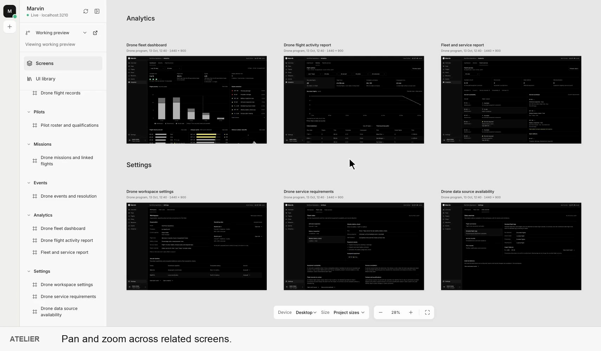
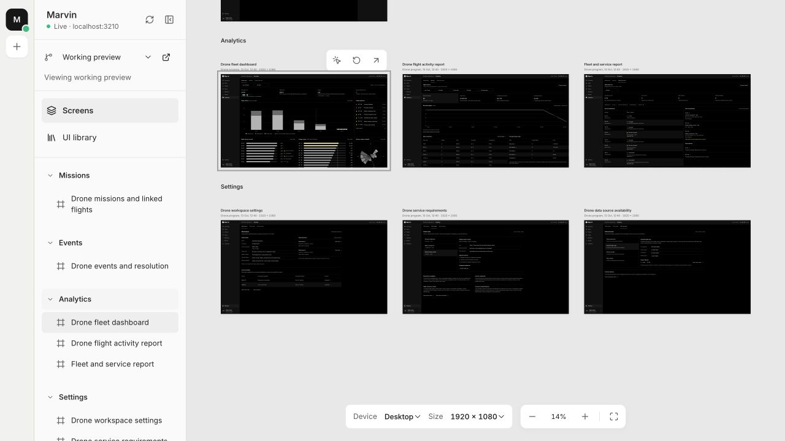
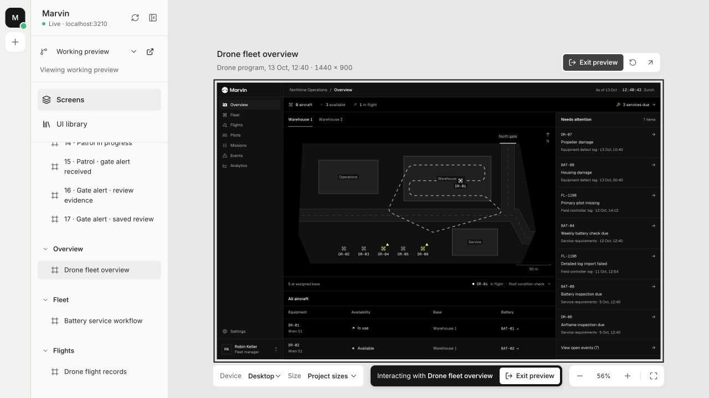

# Atelier

**Review working product screens together.**

Atelier is a local workspace for reviewing coded prototypes on a pannable, zoomable canvas. See related screens side by side, focus on one, then enter it to try the real interaction. Each project keeps its own code, styles and data.

**[Watch the 36-second demo](https://nicolas-m-design.github.io/atelier-showcase/)** · [Download the MP4](https://raw.githubusercontent.com/nicolas-m-design/atelier-showcase/main/assets/atelier-demo.mp4)

*Move around the canvas, focus a screen, then enter it to switch between Marvin’s two fictional warehouses. Captions sit outside the product preview. [Recording and review notes](docs/demo-video.md).*

[Explore the Marvin project shown here](https://github.com/nicolas-m-design/marvin-showcase) · [See my portfolio](https://nicolasmenard.design)

*Move between a view of several screens and the details of one. These captures show Atelier running locally with Marvin’s fictional fleet data.*

## From the canvas to a working screen

1. **Choose a project.** The project rail switches between connected prototypes. The sidebar lists their screens and any linked pages, such as a component library.
2. **Review related screens together.** Screens appear in named groups. Pan, zoom or choose a screen in the sidebar to bring it into view.
3. **Try the interaction.** Double-click a screen, or enter a selected preview, to use its links, forms and scrolling. Exit the preview to return to navigating the canvas.
4. **Check another layout size.** Desktop, tablet and mobile presets change the preview viewport. Project sizes restores each screen’s authored dimensions.

*The screen remains a running page. Atelier’s presentation controls sit outside it.*

## Why a separate workspace?

A coded prototype can spread a flow across many routes and states. Atelier brings those screens into one review space while keeping the implementation in its original project.

Three decisions shape the tool:

- **Separate navigation from interaction.** Selecting a frame moves around the review space; entering it passes input to the product. A click intended to select a screen does not activate a control inside it.
- **Let projects describe their own screens.** A small manifest supplies groups, routes and dimensions. Atelier displays those pages without copying their components or styling.
- **Keep the review controls outside the product.** Project switching, sizing and zoom belong to Atelier. Each framed screen keeps its own interface.

## What is built

- A browser workspace with project switching, grouped screens, pan and zoom.
- Live previews with separate selection and interaction modes.
- Desktop, tablet and mobile viewport presets, plus each project’s original screen sizes.
- Linked project pages, such as UI libraries.
- A personal Mac app using the same workspace.
- Configurable previews of committed local branches on macOS.

The workspace uses React and TypeScript with a local Node server. The Mac app hosts it in a Swift/AppKit window with WKWebView. Connected projects serve their own pages; Atelier reads their screen manifest and embeds the previews.

Viewport presets help review responsive layouts. They do not emulate a physical device’s touch input, browser chrome or pixel density.

## Availability

Atelier currently runs locally. This repository is a public showcase with a demo video and screenshots; the application source remains private. There is no public app download or hosted Atelier demo.

The screenshots use [Marvin](https://github.com/nicolas-m-design/marvin-showcase), a separate product design prototype with synthetic operational data. [Try Marvin’s hosted demo](https://marvin.hi-3b5.workers.dev) to explore that project.
